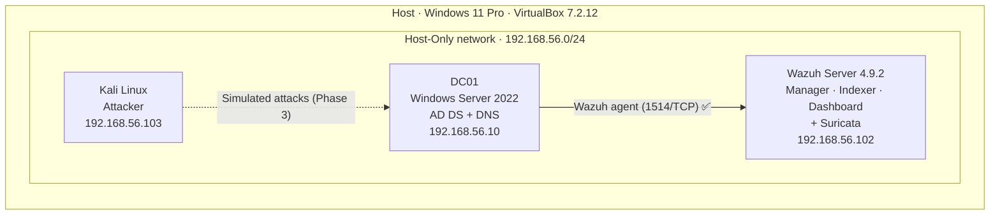

# 🛡️ Corporate SOC Simulation — Nimbrek S.A.


A corporate Windows domain built from scratch to practice the full SOC cycle — **build, monitor, attack, detect and respond** — against Active Directory, the identity backbone of most organizations and one of the first things an attacker goes after.

This is the second project in my Blue Team portfolio. It extends my [Home SOC Lab](https://github.com/ddiazcr/home-soc-lab), reusing the same Wazuh SIEM, Kali attacker and AI triage pipeline, and moves the scenario from a single vulnerable Linux host to an enterprise identity environment.

> **Fictional company:** Nimbrek S.A. · **Domain:** `lab.local` · **Environment:** isolated home lab (VirtualBox, Host-Only network)

---

## 📍 Project status

| Phase | Scope | Status |
|---|---|---|
| **1 — Infrastructure** | Domain controller, `lab.local` forest, Nimbrek S.A. structure | ✅ Complete |
| **2 — Visibility** | Wazuh agent on the DC, advanced audit policies via GPO | 🟡 In progress — agent enrolled and active |
| **3 — Attack & detection** | Attacks from Kali mapped to MITRE ATT&CK, custom detections, honeytoken | ⏳ Planned |
| **4 — AI triage** | Reuse the Home SOC Lab AI pipeline on Active Directory alerts | ⏳ Planned |
| **5 — Hardening** | AD security audit with before/after measurement | ⏳ Planned |

---

## 🗺️ Architecture



| Component | Details |
|---|---|
| Operating system | Windows Server 2022 Standard Evaluation (Desktop Experience) |
| Resources | 2 vCPU · 4 GB RAM · 60 GB dynamic VDI disk |
| Network | Host-Only `192.168.56.10/24`, DNS pointing to itself |
| Domain | `lab.local` · NetBIOS `LAB` · Windows Server 2016 functional level |
| Roles | Active Directory Domain Services, DNS |
| Monitoring | Wazuh agent 4.9.2 → manager `192.168.56.102` |

---

## ⚙️ Phase 1 — Infrastructure

### 1. Base server configuration

Hostname, static IP and local DNS were set before installing any roles.

```powershell
Rename-Computer -NewName "DC01" -Restart

New-NetIPAddress -InterfaceAlias "Ethernet" -IPAddress 192.168.56.10 -PrefixLength 24
Set-DnsClientServerAddress -InterfaceAlias "Ethernet" -ServerAddresses 127.0.0.1
```

### 2. AD DS installation and promotion to domain controller

```powershell
Install-WindowsFeature AD-Domain-Services -IncludeManagementTools

Install-ADDSForest `
    -DomainName "lab.local" `
    -DomainNetbiosName "LAB" `
    -DomainMode "WinThreshold" `
    -ForestMode "WinThreshold" `
    -InstallDns
```

### 3. Nimbrek S.A. organizational structure

Created with PowerShell so the environment is **reproducible**:

| Type | Items |
|---|---|
| Organizational units | IT (`TI`) · Sales (`Ventas`) · HR (`RRHH`) · Finance (`Finanzas`) · `Servidores` · `Estaciones` |
| Security groups | `GG_TI` · `GG_Ventas` · `GG_RRHH` · `GG_Finanzas` |
| Test users | 7 accounts distributed across departments |

> 🔐 Lab credentials are never published in this repository.

### 4. Validation

```powershell
dcdiag /v
Get-ADDomain | Select-Object DNSRoot, NetBIOSName, DomainMode
Get-ADOrganizationalUnit -Filter * | Select-Object Name
```

`dcdiag` passes every test except **SystemLog**, an expected and harmless failure: the Host-Only network has no internet access, so Windows logs DNS timeouts when trying to reach Microsoft's activation endpoints.

---

## 📡 Phase 2 — Visibility (in progress)

The Wazuh agent was deployed **offline**: the domain controller has no internet access, so the MSI was downloaded on the host and delivered through a read-only VirtualBox shared folder.

```powershell
Start-Process msiexec.exe -ArgumentList '/i','C:\Temp\wazuh-agent-4.9.2-1.msi','/q',
    'WAZUH_MANAGER=192.168.56.102','WAZUH_AGENT_NAME=DC01',
    'WAZUH_REGISTRATION_SERVER=192.168.56.102' -Wait
Start-Service WazuhSvc
```

Enrollment was verified from the manager:

```text
$ sudo /var/ossec/bin/agent_control -l
   ID: 000, Name: wazuh-server (server), IP: 127.0.0.1, Active/Local
   ID: 001, Name: DC01, IP: any, Active
```

**Next in this phase:** advanced audit policies via GPO (logon, Kerberos, account management, policy change) and end-to-end validation of the key Windows events in the SIEM.

---

## 🔧 Troubleshooting: what didn't work the first time

Two real incidents happened while building this lab. I'm documenting them because solving them taught me more than anything that worked on the first try.

### Incident 1 — The first domain controller couldn't be saved

| Problem | Diagnosis | Resolution |
|---|---|---|
| Update **KB5122882** hung for hours on "Working on updates" and then rolled back | The host has **Hyper-V/VBS enabled at firmware level**, so VirtualBox runs on top of the Windows hypervisor with much lower disk I/O | Mitigate instead of remove: 2 vCPU, frequent snapshots, *headless* mode |
| `Install-WindowsFeature AD-Domain-Services` failed with **0x800f0827** | Servicing stack left in an inconsistent state by the half-applied update (`CBS_E_STACK_SHUTDOWN_REQUIRED` in `CBS.log`) | Repairing the VM was ruled out |
| The VM froze on reboot | System state not recoverable at a reasonable cost | **Clean rebuild (DC01-v2)**, keeping the original VM as evidence before deleting it |

**Deliberate decision:** Windows Update stays disabled in this isolated, offline lab to ensure stability. In production this would be unacceptable — a domain controller must be kept up to date.

### Incident 2 — The SIEM went silent

After deploying the agent, the DC could not reach the manager on ports 1514/1515.

| Step | Finding |
|---|---|
| Network check from DC01 | ARP resolved the host, but nothing answered at `192.168.56.102` |
| Manager status | `wazuh-manager` **failed**: *"No space left on device"* |
| Disk usage | Root filesystem at **100%**; `/var/ossec/queue/vd_updater/tmp` held **12 GB** of vulnerability-feed temporary files |
| Cleanup | Temporary files removed → disk at **55%** (11 GB free) |
| Second failure | Manager start killed by **systemd timeout** on slow I/O |
| Fix | Drop-in override `TimeoutStartSec=600` for `wazuh-manager.service` → service active, listening on 1514/1515 |

**Lessons learned**

- Knowing when to stop repairing and rebuild from a known-good state is an operational skill. Per-phase snapshots made the rebuild fast and safe.
- "The agent can't connect" is not always a network problem — check the service on the other end first.
- Monitoring the monitoring stack matters: a SIEM with a full disk fails silently.

---

## 📸 Evidence

| | |
|---|---|
|  |  |
| *DC01 hostname and Windows Update disabled* | *Static IP and local DNS* |
|  |  |
| *AD DS role installed* | *Forest `lab.local` created* |
|  |  |
| *`dcdiag` validation* | *Nimbrek S.A. OUs, groups and users* |


*DC01 enrolled and active in the Wazuh manager*

<details>
<summary>🔧 Troubleshooting evidence</summary>


*Original VM configuration*


*AD DS installation failing with 0x800f0827*


*Root cause in `CBS.log`: `CBS_E_STACK_SHUTDOWN_REQUIRED`*


*Recovery attempts on the original VM*


*Original VM powered off, DC01-v2 in service*

</details>

---

## 🚀 Roadmap — Phase 3 attack & detection plan

| Technique | MITRE ATT&CK | Key Windows event |
|---|---|---|
| Brute force | T1110.001 | 4625 |
| Password spraying | T1110.003 | 4625 / 4771 |
| Kerberoasting | T1558.003 | 4769 (RC4 encryption `0x17`) |
| Domain account discovery | T1087.002 | 4661 / 4662 |
| Privileged group changes | T1098 | 4728 / 4732 / 4756 |

Planned deliverables:

- [ ] Advanced audit policies via GPO
- [ ] Custom Wazuh rules for each technique, with true/false positive results
- [ ] Honeytoken service account to detect Kerberoasting with zero false positives
- [ ] Incident report per attack (timeline, IOCs, response)
- [ ] AI triage of AD alerts using the [Home SOC Lab pipeline](https://github.com/ddiazcr/home-soc-lab/tree/main/AI)
- [ ] AD hardening with before/after measurement

---

## 🧰 Tech stack

`Windows Server 2022` · `Active Directory` · `DNS` · `PowerShell` · `Group Policy` · `Wazuh` · `Suricata` · `Kali Linux` · `VirtualBox` · `MITRE ATT&CK`

---

## 👤 Author

**Daniel Díaz** — Advanced Cybersecurity Technician focused on Blue Team / SOC · Costa Rica
[LinkedIn](https://linkedin.com/in/danieldiazcr) · [GitHub](https://github.com/ddiazcr)

*This project is for educational purposes only, built entirely within an isolated home lab environment.*
